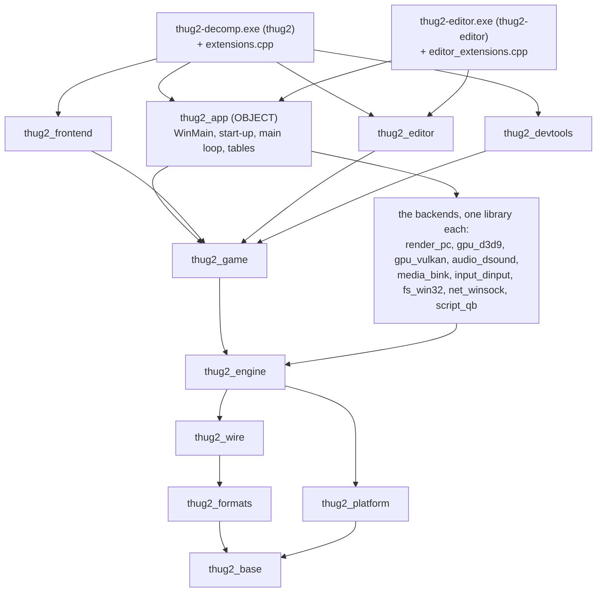

# Architecture

## Layers

The source is built into two executables: `thug2-decomp.exe` (CMake target `thug2`: the game, with the new front end,
the level editor and the developer tools) and `thug2-editor.exe` (target `thug2-editor`: the level editor on the engine
and the game, with no new front end and no developer tools). Both are made from `src/`, in layers. A layer may include
the layers below it, never the ones above. Each layer but `app/` is a static library, `thug2_<folder>`, defined in its
folder's `CMakeLists.txt`; `app/` is the object library `thug2_app` (WinMain, the start-up, the main loop and the
tables) that the two exes share, each adding its own extension list.

```
app/                        main, WinMain, the start-up, the game's main, the two exes' extension lists: the composition (may include anything)
editor/  frontend/  devtools/   the level editor; the new front end and mouse menus; the developer tools
game/                       skating, the rider, goals, parks, saves, the online session (game/online)
render_pc/                the graphics backend's API-neutral half: the original's PC platform layer over render::Gpu; only app/ includes it
gpu_d3d9/                 Direct3D 9's Gpu, GpuContext and UiBackend, D3DX; only app/ includes it
gpu_vulkan/               Vulkan's Gpu and GpuContext (renderer=vulkan: design/vulkan.md); only app/ includes it
audio_dsound/  media_bink/  the sound backend (DirectSound) and the movie codec (Bink); only app/ includes them
input_dinput/               the original's DirectInput side, an input source; only app/ includes it
fs_win32/                   the operating system's files (Win32's), under the file system; only app/ includes it
net_winsock/                the network sockets and address lookups (Winsock's), under the transport; only app/ includes it
script_qb/                  the QB script interpreter, behind the script host; only app/ includes it
engine/                     memory, lists, files, assets, script (the data model and the host), objects, renderer, audio,
                            media, network transport, pad input, ui (the original's screen elements), ext (the extension points)
-------------------------   the boundary: where bytes come from outside the game
formats/  wire/             file formats; network messages
platform/                   Win32, the SDL window, the GameSpy SDK, crash reports, code addresses
-------------------------
base/                       checksums, formatting, text, checked indexing, maths, the bit stream (no OS, no SDK)
```

**The base layer** (`src/base`, static library `thug2_base`) is what every layer uses and nothing of the OS: `core`
(checksums, printf-style formatting, text, number parsing, checked indexing, the enum, cast and pointer helpers, the
compiler's few names), `maths` (vectors, matrices - their product, the vector transforms and the viewing matrices are
D3DX's in plain C++, bit for bit, checked by `thug2_maths_check` -, quaternions, shape tests), `lists` (two containers
that don't use the game's heaps) and `util` (the bit stream, BPS patches). It includes only the standard library and GSL
(and the compiler's SSE intrinsics: the reciprocal estimates D3DX's normalising uses). What it can't do itself it hands
to a sink the platform installs first thing in WinMain (`platform/output_sinks.h`): the debugger output
(`base/core/dbg.h`) and error lines into thug2-decomp.log (`base/core/log_sink.h`). The game's heaps are `engine/memory`
(they use the run log, the C runtime's heap and the game config), and what is built on them stays in the engine
(`engine/lists`' chains and maps, `engine/util`'s LZSS compressor and text store).

**The platform layer** (`src/platform`, static library `thug2_platform`) is the OS and the SDKs, and includes only
`base/` and their headers. It doesn't call up: what the game does on the platform's events, and where it keeps the
platform's devices, is wired by `app/`. The SDL event pump calls the handlers registered with it (the quit request is
the start-up's, `app/pc_setup.cpp`; the window's focus WinMain's); `sys::create_sdl_window` returns the window's
handle, which WinMain keeps where the platform's window is (`sys::game_window`); the sound output WinMain opens through
`audio::Device` and keeps in the audio's state; the base layer's sinks are installed by `app/main.cpp`. What uses the engine's state is the engine's: the frame
clock (`engine/sys/stopwatch`, `game_clock`), the input set-up and the tables the original's input read with - the
ports' controls, the key names, the registry options (`engine/pad_input/input_setup`, `port_controls`); the
original's DirectInput side itself is a backend (`src/input_dinput`, "The input seam" below).

**The composition** (`src/app`): `main.cpp`, WinMain (`winmain.cpp`: the command line, the window, the devices),
PartyMod's start-up (`pc_setup.cpp`) and the game's main (`startup.cpp`: the singletons, modules and the main loop).
It may include every layer. `src/devtools` sits beside the editor and the new front end: the screenshot key, the
test-automation channel (`automation`) and the restart tester (starting in a level, `game/front_end/start_level`, and
the test views, `game/rider/test_view`, are the game's, which the editor and the dev tools both use).

**The extension points** (`engine/ext/extension.h`): the engine and the game never call the editor, the front end or
the dev tools. Where something we added runs inside the original's frame, the original code calls `ext::` at that
place - the front end's input logic (`ext::menu_frame`), the 3D frame (`before_draw_world`, `place_camera`,
`near_plane` / `view_angle`, `view_drawn`, `draw_over_frame`), the main loop (`before_present`, `keeps_every_frame`,
`device_lost`), the screen elements' layout pass, the input set-up and poll (`prepare_input`, `game_owner` and its
`pass_pause_key`, `game_input_blocked`; the buttons a dev tool presses are an input source's, "The input seam"), a scene
loaded, the data overlay, the start-up's movies,
the career save and the high scores - and where one of ours asks another (a feature switch the options screen sets,
the game drawn unfocused for a test, the editor opened in the level -edit loads, the screens a test drives) - and
`ext::` calls each registered `ext::Extension` in turn. An extension
overrides only its points (the defaults do nothing or pass the value on); a point that returns a value keeps the
contract its one caller had (the first extension that owns the game takes the keyboard but for the Pause key; the
near plane and field of view are passed from one extension to the next, starting from the original's). The grain is
a few calls per frame, viewport or event. `app/extensions.cpp` is the exe's composition: it registers the extensions
in the one order that is every point's call order (the mouse menus, the restart tester, THAW's BMX, the editor, debug
mode, the start level, automation, the test view, the new front end, the screenshot key) and registers their script
commands where the start-up did. The editor exe's `app/editor_extensions.cpp` registers the editor and the game
features it wants (THAW's BMX, debug mode, start level) in the same relative order. Our NOT ORIGINAL game and engine features that run at those points (THAW's BMX, debug mode) are extensions
too; what the editor drives inside the game stays in the game (`game/skate/edited_copy_career`: the edited copy
kept out of the career save, its gaps asked of the extensions).

**Where the UI lives** (what `frontend/` held was three things): the original's screen elements, which the game's HUD
and menus use (`screen_element*`, `text_element`, `text_block`, `menu_element`, `sprite_element`, `scrolling_menu`,
`model_widget`, `theme_cfuncs`, `screen_constants.h`), are `engine/ui` (they include no game header); the original's
pause / menu module is `game/front_end`, CREATE 100% CAS's commands `game/commands`, and the data overlay (a file
system source) `engine/file/data_overlay`. `src/frontend` is now the new front end and the mouse menus only. The
namespaces are the ones the files had (`frontend::` for all of these).

**Where the network code lives**: `engine/net` is the transport only (the app, connection, dispatcher, manager and
client objects, message framing and compression: `net_*`, `shared_state.h`); it includes no game header. The
online session - the GameSpy lobby, rooms, buddies, the content vault, stats, the player roster, the game-flow
messages and handlers, the THUGPRO peer mode and guards - is `game/online` (74 files, namespaces `online::` and
`net::` as they were). The two things the transport asks of the session are hooks set by the exe before any original
code runs (`online::install_transport_hooks`, game/online/transport_hooks.h): the peer-mode question
(`net::set_peer_mode_query`) and the check on received messages (`net::set_received_message_check`). The rest of
the engine asks the session through `net::SessionQueries` (below); the text-entry flag the session sets is the
input's (`sio::text_entry_flag`), and the handler that does nothing is the dispatcher's (`net::handle_nothing`).

**Where the script commands live**: the game's script commands (CFunctions) that read the skater, the session, the goals or the
parks - `game_cfuncs`, `game_flow_cfuncs`, `game_util_cfuncs`, `trick_cfuncs`, `world_cfuncs`, `net_state_cfuncs`,
`node_object_cfuncs`, the create-a-graphic and face-texture commands, and the code half of the member-function tables
(`member_function_code`) - are `game/commands`; the commands that only use the engine stay beside it in
`engine/script`, `engine/gfx`, `engine/objects`, `engine/ui` and `engine/sound`. The script data stays in
`engine/script`; the interpreter is `script_qb/`, behind `script::Host` ("The script host seam"). The command table itself - the 1,254 commands and the 250 member-function names, in the
original's order, which is a command's identity in the script symbol tables - is composed in `app/command_table.cpp`,
the one place that sees every library, and handed to the script engine before any original code runs
(`app::install_command_tables`; `script::cfunction_table()` is the engine's view of it). The start-up initialisers'
sequence (`app/startup_init.cpp`) is in `app/` for the same reason. The engine's two uses of node commands (the time of
day creating an object from a node, the colour cycles setting a node's colour) go through hooks installed by
`commands::install_node_hooks` (`engine/script/node_hooks.h`).

**Where the object components live**: `engine/objects` is the object framework (the entity, its modules and their
manager, the model, skeleton, animation blender, sound, collision, motion, rigid body, input, camera, cutscene and
node components) and the components that need nothing of the game. The components that are the game's own - the
drivable vehicle (`vehicle_*`), the peds (`ped_logic*`, `avoid`), the projectiles, the trick objects and the park
editor's camera - are `game/world`; the walk component's hanging and ladder code is `game/rider/walk_hang` beside the
rest of the walk component (its interpolation helper, which animation uses too, stays in `engine/objects/walk_lerp`).
Namespaces are as they were (`objects::`). The component registry - the 81 component types in the original's order,
which `spawn_module` searches - is `app/component_types.cpp`, called by the start-up. `engine/objects` includes nothing above the
engine: what the framework asks of the game - the skate module's players, level, movie managers and viewer, a node left
out of the game mode, the front end's controllers, the park editor's state, the skater's flip component, a
projectile's hit, the trick objects' clusters, the walk component's ladder and rail checks, THAW's BMX - goes through
`objects::GameHooks` (`engine/objects/game_hooks.h`: function pointers, each the game's own code, installed once by
`objects::install_game_hooks`, game/world/object_hooks.h, from `app/main.cpp`). What the engine asks of the online
session - whether a network game is on (on the objects' copy of the network manager's pointer, or on the manager as it
is now), the session's client apps, the client app of this machine's player of an object - is `net::SessionQueries`
(`engine/net/session_query.h`, installed by `online::install_session_queries` at start-up where the original kept the
objects' copy of the network manager's pointer): the objects, the interpreter, the animation channels and the terrain
sounds use it. The viewport count (`modules::viewport_count`) is `engine/gfx/viewport`'s, beside the screen mode that
sets it.

**The engine includes nothing of the game.** Each engine subsystem that asks the game something has its own small
set of hooks, named for the subsystem that asks - not one set for the whole engine - and each is installed once from
`app/main.cpp` before any original code runs, by an installer on the game's side that may include any game module:

| asks | hooks | installed by | what |
|---|---|---|---|
| engine/objects | `objects::GameHooks` (`engine/objects/game_hooks.h`) | `objects::install_game_hooks` (game/world/object_hooks) | above |
| engine/gfx | `render::GameHooks` (`engine/gfx/game_hooks.h`) | `render::install_game_hooks` (game/skate/render_hooks) | the career level (the screen's aspect), multiplayer, the game mode's name, the front end's pause, the park editor's shell (the time of day) |
| engine/pad_input | `sio::GameHooks` (`engine/pad_input/game_hooks.h`) | `sio::install_game_hooks` (game/front_end/pad_hooks) | the front end's menus up, its input port, the park editor editing, THAW's BMX half-stick key |
| engine/sys | `sys::GameHooks` (`engine/sys/game_hooks.h`) | `sys::install_game_hooks` (game/skate/sys_hooks) | the main loop's GameSpy service, THUGPRO's position scale and the rail debugging after the render; the front end's pause for debug mode |
| engine/render | `render::set_feeler_query_observer` (`engine/render/probe_ray.h`) | `collision_overlay::install` (game/rider/debug_collision) | `[features] debug_collision`'s log after each feeler query |
| engine/net | `net::SessionQueries`, the transport hooks | `online::install_session_queries` (at start-up), `online::install_transport_hooks` | above |
| engine/script | the node hooks (`engine/script/node_hooks.h`) | `commands::install_node_hooks` | above |
| engine/gfx (loading screen) | `gfx::loading_console::PanelHooks` (`engine/gfx/loading_console.h`) | `gfx::loading_console::install_panel` (the graphics backend) | the loading console's panel, drawn by the backend |

Each hook is the game's own code that the engine called at that place: one indirect call for a direct one, none added
per object, draw or poll. Some things moved down instead, because they need only the engine: the CAS option lists
(`engine/gfx/cas_options`), THUGPRO's CAS parts from the user's install (`engine/file/thugpro_cas`), the viewer's
pending script (`engine/sys/model_viewer`). `tools/layers.json` lists the engine (with base and platform) as strict:
no upward include, not even in the baseline.

**The rule is checked.** `tools/layers.json` maps each folder to a library and lists the libraries it may include; `node tools/layers.ts` (part of `npm test`) fails on any include outside the map that is not in `tools/layers_baseline.txt`, and on any baseline line that no longer occurs - the baseline can only shrink. The editor is its own layer above `game`, beside the front end and the dev tools: none of the three includes another (every library but the app's is strict, and the baseline is empty). What the editor and the front end may include of the engine and the game is an explicit list each, the `api` of their entry in `tools/layers.json`: an include of another engine or game header fails, and so does a listed header none of their files includes (`node tools/layers.ts --api editor` prints what they use now). What they share went down a layer: reading the original menus' screen elements (`engine/ui/menu_reading.h`, from the mouse menus), a menu pad event as the front end sends it (`game/front_end/menu_pad_event.h`), the Dear ImGui layers' backend (`engine/ui/ui_backend.h`), the gap and combo trackers and what feeds them (`game/skate/play_trackers.h`), starting in a level (`game/front_end/start_level.h`, with the test views' teleport, `game/rider/test_view.h`); what one asks of another goes through the extension points (`feature_switch`, `draws_unfocused`, `open_editor_when_up` / `editor_opening_frame`, the driven screens' `screen_command`...; `ext::game_owner()` for "the editor runs"). A file that only needs the name of a class takes it from the owning subsystem's `fwd.h` (`engine/script`, `engine/objects`, `game/online`, `engine/memory`, `base/maths`), not from a header of a higher layer.

**The libraries link as the map says.** Each library links only the ones its layer may include (`PUBLIC`: their
headers are part of its own), and reaches every one of them through those links. An arrow points at what a library
links:



(Each exe also links the libraries it reaches through these, listed out in `src/app/CMakeLists.txt`.) The editor,
the front end and the dev tools each link `thug2_game` (and Dear ImGui) alone, never one another: `thug2-editor` reaches
neither the front end nor the dev tools. Only the exes (through `thug2_app`) link the backends. The checks in
`src/tests` link only what they check (`thug2_format_check`: wire and formats; `thug2_maths_check`: base;
`thug2_parse_check` / `thug2_printf_check`: formats; `thug2_vulkan_context_check` / `thug2_ff_shader_check` / `thug2_vulkan_gpu_check`: the Vulkan backend). Third-party and system libraries are linked by the
library that calls them (SDL, D3D9 and the GameSpy SDK by the platform - the SDK links Winsock for itself -; Winsock by
the network backend; LZHAM by the engine; DirectInput
by the input backend; DirectSound by the sound backend; D3DX by the graphics backend; volk, the Vulkan headers and the memory allocator by the Vulkan backend; imgui's core by the graphics backend - the loading console's
panel -, the editor and the front end, and imgui's SDL2 and Direct3D 9 backends, `imgui_backends`, by the graphics
backend alone).

**The checks that hold all this** run in `npm test`:

| check | what it enforces |
|---|---|
| `tools/layers.ts` (`layers.test.ts`) | The layer map `tools/layers.json`: each folder belongs to a library, and an include outside the library's `allowed` list fails unless it is in `tools/layers_baseline.txt` (a ratchet: it can only shrink, and is empty now). Every library but the app's is `strict`: no upward include, not even in the baseline. The editor's and the front end's `api` are explicit lists of the engine and game headers each may include; a header outside the list fails, and so does a listed header none of their files includes (`node tools/layers.ts --api editor` prints what they use now). |
| `tools/cmake_layers.ts` (`cmake_layers.test.ts`) | The CMake files against the same map: a library links only what its layer may include and reaches every library the map allows it; a source sits in its own library's folder; a `.cpp` is compiled by exactly one target; a sibling link needs baseline lines between the two. The map's `executables` lists what an exe must reach without (`thug2-editor`: neither the front end nor the dev tools). |
| `tools/d3d_headers.test.ts` | `<d3d9.h>` / `<d3dx9*.h>` are included only by `gpu_d3d9/` (Direct3D's own headers there); `render_pc/` includes none, nor any of `gpu_d3d9/`'s headers, and only `app/` picks `gpu_d3d9/`'s Gpu, GpuContext, UiBackend and `render_pc/`'s device; every other header holds the graphics handles. |
| `tools/vulkan_headers.test.ts` | The Vulkan headers (`<vulkan/...>`, volk, the memory allocator, `<SDL2/SDL_vulkan.h>`), the shader compiler's (glslang, SPIRV-Tools) and Vulkan's functions only in `gpu_vulkan/` and its checks (`src/tests/vulkan_context_check.cpp`, `src/tests/ff_shader_check*.cpp`, `src/tests/vulkan_gpu_check.cpp`); only `app/` includes the backend. |
| `tools/audio_headers.test.ts` | `<dsound.h>` only in `audio_dsound/`; the Bink wrapper only in `media_bink/`; only `app/` picks `audio::Device` and `media::Movie`. |
| `tools/input_headers.test.ts` | `<dinput.h>` only in `input_dinput/`; SDL's input and the platform's keyboard only behind the SDL input source; only `app/` picks the sources. |
| `tools/file_calls.test.ts` | The operating system's and the C runtime's file functions are called only in `fs_win32/`, `platform/` and `src/tests`; only `app/` installs the disk and adds the file sources. |
| `tools/net_calls.test.ts` | Winsock's headers and functions only in `net_winsock/`; only `app/` installs the transport. |
| `tools/script_headers.test.ts` | The interpreter's headers only in `script_qb/` and `app/`; only `app/` installs the host; nothing outside `script_qb/` names its classes. |
| `tools/layering.ts` (`layering.test.ts`) | The named views of in-memory layouts (`cell::`, `raw::`, `bits_as`, `function_at`) only in the boundary files. |
| `tools/no_nolint.test.ts` | No `NOLINT` in `src/`. |
| `tools/clang_tidy_filter.test.ts` | `.clang-tidy`'s header filter covers every folder of `src/` (a header outside it is never reported) and leaves out the fetched libraries and the build's generated headers. |

Nothing is registered by a static initialiser: the start-up runs explicit tables (app's start-up initialisers, the
command table, the component registry), so the linker drops no object the game needs (a static library leaves out an
object nothing refers to). The project's only dynamic initialisers are four list-head markers and one callback
pointer, each used in its own file. Each library keeps its sources in the order the exe listed them before the
split; the exe's symbols were compared before and after.

## Seams

A seam is an interface in the engine with an implementation in a library of its own. The engine and everything above
it call the interface; `app/main.cpp` makes the implementation and installs it before any original code runs (the
editor exe's start-up is the same code), so only the exes link a backend, and swapping one means installing another at that
place. The grain of every interface is coarse - a frame, a resource, a state block, a batch, a socket, a
file, a script operation - never a vertex, a sample, a byte or a statement.

| interface | declared in | implemented by | what it hides | other implementations |
|---|---|---|---|---|
| `render::Device`, `render::UiBackend`, `render::Gpu` | `engine/gfx/render_device.h`, `engine/gfx/ui_backend.h`, `engine/gfx/gpu.h` | `thug2_render_pc` (`render::d3d9::device()`: `render::Device`, over `render::Gpu`) and `thug2_gpu_d3d9` (`render::d3d9::gpu()`, `gpu_context()`, `ui_backend()`) | Direct3D 9, D3DX, ImGui's Direct3D 9 / SDL2 backends | Vulkan (`thug2_gpu_vulkan`: `render::vulkan::gpu()`, `gpu_context()`, `ui_backend()` - drawing, with the screen effects and the ImGui parts: [design/vulkan.md](design/vulkan.md)) |
| `audio::Device` | `engine/audio/audio_device.h` | `thug2_audio_dsound` (`audio::dsound::device()`) | DirectSound: the output, the voices, the listener | the muted output (`engine/audio/muted_device.h`) over it |
| `media::Movie` | `engine/media/movie.h` | `thug2_media_bink` (`media::bink::movie()`) | Bink (the player's binkw32.dll): movies and sound streams | FFmpeg's Bink decoder (planned, for a 64-bit build) |
| `input::Source` | `engine/pad_input/input_source.h` | `thug2_input_dinput` (`input::dinput::keyboard()`) | the original's DirectInput side; SDL's source (`engine/pad_input/sdl_input.cpp`) and the automation channel's are the others | - |
| `fs::FileSystem` (its `fs::Source`s), `fs::Disk` | `engine/file/file_system.h`, `engine/file/disk.h` | `thug2_fs_win32` (`fs::win32::disk()`); the sources are the engine's (overlay, archives, Data folder) | the operating system's files | a std::filesystem / POSIX disk (for a GCC build) |
| `net::Transport` | `engine/net/transport.h` | `thug2_net_winsock` (`net::winsock::transport()`) | Winsock's sockets and lookups | `engine/net/loopback_transport.h` (in-process, for protocol tests: `[debug] net_loopback=1`) |
| `script::Host`, `script::Context` | `engine/script/host.h`, `engine/script/context.h` | `thug2_script_qb` (`script::qb::host()`) | the QB interpreter | a QuickJS runtime (planned: [qb-js-plan.md](qb-js-plan.md)) |
| `ext::Extension` | `engine/ext/extension.h` | `thug2_frontend`, `thug2_editor`, `thug2_devtools`, and the game's features (THAW's BMX, debug mode) | what the original's frame lets our additions do | - |

`script::Context` is not a backend seam: it is the view of the running script that every command receives
(`bool f(script::Struct* params, script::Context context)`), so the commands do not depend on the runtime's record. The
extensions are the other way round: the engine calls out to code above it, through `ext::` ("The extension points",
above), and `app/extensions.cpp` / `app/editor_extensions.cpp` register them.

The engine's own questions of the game go through small per-subsystem hook structs, each declared beside the subsystem
that asks and installed by a function on the game's side: the table under "The engine includes nothing of the game"
(Layers, above) lists where each lives (`engine/objects/game_hooks.h`, `engine/gfx/game_hooks.h`,
`engine/pad_input/game_hooks.h`, `engine/sys/game_hooks.h`, `engine/net/session_query.h`, `engine/script/node_hooks.h`)
and who installs it.

## The boundary and the backends

**The boundary layer** is where the game meets bytes it doesn't lay out itself. Only there do byte layouts matter;
everything above it uses the game's own types and may change them freely.

- `formats/` (static library `thug2_formats`): a reader - and, where the game writes the format, a writer - for each
  file the game loads or saves (and, for the files used in place - collision, animation keys - the accessors that read
  their records, e.g. `collision_format::FaceTable` for a collision object's faces, `relocate_object` /
  `object_record` / the tree's link accessors for its fix-up in place): PRE archives and their LZSS (`pre_format`, `lzss`), cutscene bundles, texture
  dictionaries and images, scenes / models / skins (`scene_format`), collision, skeletons, animations, fonts, sound
  effects, the streamed sounds' index, the park map and its rails, the save file. Each takes a byte span
  (`ByteReader` / `ByteWriter`, `byte_stream.h`: little-endian, unaligned, bounds-checked) and gives plain records.
  `thug2_format_check` (`tests/`) runs every reader over a game folder, compares it with an independent
  reading of the bytes, and round-trips the writers.
- `wire/` (static library `thug2_wire`): the packet framing (`net_wire`) and every game message
  (`gamenet_messages`, `skater_messages`, `play_messages`, `skate_net_messages`), byte-compatible with the
  original's and THUGPRO's peers. Encoders and decoders over the same byte stream; a short or oversized message is
  refused, not read past.
- **The graphics backend** is two static libraries on the engine: `src/render_pc` (`thug2_render_pc`), the API-neutral
  half, and `src/gpu_d3d9` (`thug2_gpu_d3d9`), Direct3D 9's Gpu, GpuContext and UiBackend plus D3DX (below). `render_pc` is the original's PC
  platform layer: the engine's `s_plat_*` calls and what they reach (0x004B2270-0x004E0A90 in the reference build), the
  Direct3D files of our own and the GPU buffers. It implements `render::Device` (`engine/gfx/render_device.h`); the
  engine side (the engine's own graphics, the objects, scripts, UI, file loading, the game, the dev tools) asks it for
  everything through that: the frame (begun, drawn, finished), a lost device's reset in the main loop's steps, the
  resources it makes and gives back (scenes, meshes, models, geoms, sprites, primitive drawers, render targets, texture
  dictionaries and projections, viewports, particle systems, fonts), the state blocks (fog, gamma, the 2D clip, the
  primitives' states, the world's lights), the effects a batch at a time (a flash, a shatter, a splat set, a texture
  shadow, the sun's occlusion query) and what is shown (screenshots, the back buffer's copy, the disc error and loading
  screens). A call per frame, resource, state block or batch - never per vertex or object: what the engine does per
  vertex (a primitive drawer's vertices: `VertexRun`, `engine/gfx/vertex_run.h`, writes them inline; a splat
  triangle's collapse, `engine_splats.h`) or per object (the occluders and sphere tests, `engine/gfx/occlusion.cpp`:
  CPU culling) is the engine's own code. The device takes and returns the engine's own types (`WorldScene`,
  `SubMesh`, `TextureSet`, `ViewRegion`, `Shatter`, `VertexRun`...); the backend's objects derive from them. The
  loading console's panel, which the backend draws over the loading screen, is reached through four hooks
  (`gfx::loading_console::install_panel`). `app/main.cpp` installs Direct3D 9's (`render::d3d9::device()`,
  `render_pc/d3d9_device.cpp`: each method is the platform layer's own function) before any original code runs,
  through `app::install_renderer` (`app/renderer_choice.cpp`): `[Graphics] renderer=vulkan|d3d9` (default vulkan; `d3d9` for Direct3D 9) picks the
  backend for both exes, and WinMain makes the window for the same API (`sys::create_sdl_window(sys::WindowApi)` adds
  SDL's Vulkan flag). Vulkan installs render_pc's device over the Vulkan `Gpu` and `GpuContext` (`install_vulkan`
  in `renderer_choice.cpp`), after asking, before the window is made, whether the device it would use can draw
  (`render::vulkan::usable`: the loader, Vulkan 1.3's dynamic rendering, push descriptors) - Direct3D 9 runs when it
  can't, and in a build without `THUG2_VULKAN` (both with a log line); `[Graphics] vulkan_device` picks the GPU. Nothing below `app/` includes or links it
  (tools/layers.json: render_pc and gpu_d3d9 are strict and only the app may include them; neither includes or links the other - the pixel shaders' assembly and the screen shot's JPEG, D3DX's in Direct3D 9, are `Gpu` operations), so the engine, the game, the editor and
  the front end build without Direct3D.
  - `render::Gpu` (`engine/gfx/gpu.h`): the low interface under the platform layer, which it calls where it called the
    Direct3D 9 device (design/vulkan.md, "A Vulkan backend: the shape"): resources made, locked and released (textures,
    vertex and index buffers, render targets and depth surfaces, occlusion queries), the state block (render states,
    texture stages, samplers, textures, the vertex format, the pixel shader and its constants, the material, the
    lights, the transforms, the viewport - Direct3D 9's numbers, recorded as they pass, so another API derives its
    shaders and pipelines from it), draws per batch (from buffers or from memory), clears, the scene, present. One
    call per device call; Direct3D 9's (`gpu_d3d9/gpu_d3d9.cpp`) passes each on unchanged, and `app::install_renderer`
    installs it with the device. The render-state cache (`render_state.cpp`, `primitive_states.cpp`) and the device's
    state and clear wrappers, the meshes' buffers, drawing, materials, instances and pixel shaders go through it already
    and include no Direct3D header (tools/d3d_headers.test.ts); the particles, billboards, weather, grass, glows, splats and
    shatter do too; the screen effects, shadows and 2D still call the device directly until they are moved over.
  - What our level editor asks of it (`render::Device`, "what our level editor asks"; `render_pc/editor_support.cpp`):
    whether the device is made, its view modes (`engine/gfx/view_modes.h`), its old HUD's lines, a PC geom's meshes,
    mesh array, instance and active flag, the buffers its ground tool makes and their upload and release, and the Add
    palette's preview (the camera, a geom drawn, the frustum put back). The editor reads and edits a sector's meshes
    through the PC geometry's records - `engine/gfx/mesh_records.h`: a vertex buffer's, an index buffer's, a mesh's and
    the first part of an instance's, the original's layouts; the backend's `VertexBuffer`, `IdxStore`, `MeshRef` and
    `Singleton` derive from them and add what they do.
  - `render::UiBackend` (`engine/gfx/ui_backend.h`): what our Dear ImGui layers - the editor's UI and the new front
    end - ask of it, a frame at a time: ImGui's platform and renderer backends started on a context, a frame begun and
    its draw data drawn, the device objects dropped before a reset, the images ImGui shows (made from texels in memory)
    and the two targets the renderer draws into for the UI (the preview, the thumbnails' atlas). Direct3D 9's
    (`gpu_d3d9/d3d9_ui_backend.cpp`: ImGui's SDL2 and Direct3D 9 backends) is installed by `app::install_renderer` beside the
    device; Vulkan's (`gpu_vulkan/vulkan_ui_backend.cpp`) keeps ImGui's SDL2 backend and draws the lists through the Vulkan `Gpu`. Both layers
    reach it through `engine/ui/ui_backend.h` (`frontend::ui_backend`), which keeps what is the UI's own (whether a
    context is started, the log, the draw data scaled to the back buffer). Only `gpu_d3d9/` and `gpu_vulkan/` (the SDL2 one) include ImGui's backend headers (tools/d3d_headers.test.ts).
  - D3DX: only the backend calls it (`gpu_d3d9/d3dx.cpp`: the pixel shaders' assembly and the front buffer's JPEG).
    Its maths - the vector transforms and the viewing matrices - is plain C++ in `base/maths/view_transforms.h`, the
    same float operations in the same order as the D3DX9 the game ran with (thug2_maths_check compares each with
    d3dx9_43.dll; bit for bit with the x87 at 53 bits, the precision the game's thread runs at - the frames drawn
    with the builders worked at 24 bits differed from D3DX's in their last bits -, but the matrix inverse, whose one
    caller doesn't use the result).
  - Its vertex and index buffers (`vertex_buffers`): made, filled through their copies in memory, written again after
    a device reset, torn down. Code outside the backend reads and writes vertices by attribute through
    `gpu::VertexView` / `VertexWriter` (`engine/gfx/vertex_view.h`: a stride and offsets, never the bytes themselves).
  - The graphics handles (`engine/gfx/gpu_handles.h`): what a header outside Direct3D's own files holds of the graphics
    API's objects - `render::GpuDevice`, `GpuTexture`, `GpuSurface`, `GpuVertexBuffer`, `GpuIndexBuffer`,
    `GpuInstance` -, pointers to incomplete types whose value is the object's own pointer (no wrapper or table: a
    handle costs what the original's pointer did). The backend converts them (`gpu_d3d9/d3d9_handles.h`:
    `d3d9::object`, `handle`, and `out` for Direct3D's out-parameters). `<d3d9.h>` is included only by Direct3D's files
    and their own headers: `gpu_d3d9/d3d9_state.h` (the renderer's Direct3D objects - Direct3D itself, the device,
    the depth surfaces, the back buffer, the screen copies -, `render::d3d9::state()`; the backend-free rest of the
    renderer's state is `render::Renderer`, `engine/gfx/renderer.h`),
    `d3d9_handles.h` and ImGui's texture id over Direct3D's
    textures (`gpu_d3d9/imgui_texture_id.h`). The device is made through `render::GpuContext`
    (`engine/gfx/gpu_context.h`; Direct3D 9's is `gpu_d3d9/d3d9_context.cpp`: the instance, the device, the present
    parameters as API-neutral settings, the caps, the reset).
- **The audio backend** (`src/audio_dsound`, static library `thug2_audio_dsound`, on the engine) is DirectSound. It
  implements `audio::Device` (`engine/audio/audio_device.h`): the output made and released (WinMain; the platform
  layer's 0x005F59D0 / 0x005F5A00), its devices listed (the graphics device's start-up notes the last one), and the
  sound effects' voices (`engine/sound/sfx_voices.cpp`, the original's PC driver) - a buffer made from the wave's
  format and description, its 3D controls, filled whole, played from the start, stopped, its status read, its volume,
  pan and frequency set, its 3D range and place; the listener made, faced and committed. A call per voice or per
  listener update, never per sample; the units are the game's (hundredths of a decibel, samples a second). Each method
  is the DirectSound calls the original made at that place, in the same order. The output, the buffers, their 3D
  controls and the listener are handles (`engine/audio/audio_handles.h`: `audio::SoundOutput`, `SoundBuffer`,
  `SoundBuffer3d`, `SoundListener`, the objects' own pointers; `audio_dsound/dsound_handles.h` converts).
  `app/main.cpp` installs DirectSound's (`audio::dsound::device()`), or with `[features] mute_audio=1` the muted
  output over it (`engine/audio/muted_device.h`): the null output, which forwards every call but the three that could
  be heard - the audio session muted while the output is open (`platform/mute_audio.h`), every voice's volume silent,
  every movie's and stream's track at 0 (`audio::Device::track_volume`) - so the voices still play and end as with
  sound. Only `audio_dsound/` includes `<dsound.h>` (tools/audio_headers.test.ts).
- **The movie codec** (`src/media_bink`, static library `thug2_media_bink`, on the engine) is Bink: the player's own
  binkw32.dll, each export looked up by name on first use (`media_bink/bink.h`). It implements `media::Movie`
  (`engine/media/movie.h`): the movies (`render_pc/movie.cpp`) and the music and sound streams
  (`engine/audio/bink_stream*.cpp`, sound-only Bink files from a path, a file handle or memory) open, decode, step,
  seek and pause through it and set their tracks' volume and pan; an open movie is its header
  (`media::MovieHeader`, the fields of Bink's BINK the game reads). Its sound plays into the sound output
  (`use_sound_output`: the output's handle - Bink's DirectSound output on the game's DirectSound object). A call per
  movie or per frame. `app/main.cpp` installs Bink's (`media::bink::movie()`); only `media_bink/` includes the
  wrapper (tools/audio_headers.test.ts).
- **The input seam** (`engine/pad_input/input_source.h`, `input_event.h`): where the game's input comes from. An
  `input::Source` is one kind of device; `app/main.cpp` adds them in the order the original read them, which is the
  call order at every point: the original's DirectInput side (`src/input_dinput`, static library
  `thug2_input_dinput`, on the engine: `input::dinput::keyboard()`), SDL's game controllers and keyboard
  (`engine/pad_input/sdl_input.cpp`, PartyMod's input: `sio::sdl_source()`), then the test-automation channel's
  pressed buttons (`devtools/automation`, a dev tool's source: nothing pressed unless the workspace turns it on).
  - The frame: the main loop's first step (`sio::read_keyboard`, 0x005BDD60) forgets the typed characters and has
    each source read its devices (`read_frame`: DirectInput's keyboard state into its two buffers); then the SDL
    window's events are pumped (`os_layer::process_window_events`, as before).
  - A port's poll (`sio::InputPort::work_on`, once a frame for each port): the device made ready, each source's
    `begin_poll` (SDL's: the menu flags, then the pending events - pumped again here, once a port, as PartyMod did),
    the control data cleared, port 0 usable and connected, each source's `poll_port` adding its buttons, sticks and
    pressures to the port's control bytes (`input::PortPoll`; SDL's: port 0's keyboard, then the port's controller;
    then the automation channel's buttons), the bits inverted. While an extension blocks the game's input
    (`ext::game_input_blocked`, the new front end) the keyboard and the controllers give nothing; the automation
    channel's buttons still go in. A call per source per port - never per key.
  - A port's pad (`has_pad`: DirectInput's joystick read, then the port's key bindings), its motors (`rumble`: SDL's
    controllers), the start-up (`devices_made` - the original's "DirectInput made" test -, `start`: DirectInput's state
    cleared, then SDL's controllers, settings, bindings and its window handler, then `ext::prepare_input`), and the
    original pad read for `InputPort::pull_data`, which PartyMod's poll replaced (`set_pad_mode`, `set_default_keys`,
    `read_pad`, `key_down`: DirectInput's).
  - What our tools read of the devices (the level editor, the new front end, the mouse menus, the restart tester,
    debug mode, THAW's BMX): the keyboard's state (`input::keys`: one array by SDL scan code - the USB keyboard usage -,
    read by key), the mouse (`input::mouse`), the first attached controller (`input::controller`), the look's held
    mouse and the cursor (`set_relative_mouse`, `show_cursor`), the size of the window an event names
    (`window_size`) - each from the first source that has it (SDL's).
  - Their events (`input::Event`, `input::add_event_handler`): the SDL source's window handler - third in the
    platform's pump, after the quit request and the window's focus - does the game's input's own handling, then hands
    each event to the handlers added (by `ext::prepare_input`, in the extensions' order; the editor's simulation
    later): the event's kind, key, repeat and modifiers, the mouse's place, motion, button, wheel and window, a
    controller's button or axis. Dear ImGui needs SDL's own events (its SDL2 platform backend takes text typed and
    edited, the keys, the mouse and the wheel, the window's events): the event carries SDL's for as long as it is handed
    round (`Event::native`), which the editor's UI passes untouched to `render::UiBackend::process_event`; nothing else
    reads it, and a queued event keeps only ours (`Event::kept`). The scan codes are named by SDL's
    `SDL_SCANCODE_*` constants (a numbering, not a call), and SDL's window queries (its size, `sys::sdl_window`) are the
    platform's window's.
  Only `input_dinput/` includes `<dinput.h>` and only app/ picks its source; outside the platform and the SDL source
  nothing calls SDL's input (the keyboard's state, the mouse, the controllers, the cursor, the event pump), only the
  SDL source includes `platform/keyboard.h`, and only it and app/ register with the platform's pump
  (tools/input_headers.test.ts; the screenshot key's sidecar, a dev tool's note of the mouse over the window, is the
  one exception). The editor exe (`thug2-editor.exe`) adds the same sources (DirectInput's, SDL's) without the automation channel's
(`app::add_input_sources`, per exe).
- **The file system seam** (`engine/file/file_system.h`, `disk.h`): where files come from.
  - The game's data files ("levels\foun\foun.qb", "data/...") come from `fs::Source`s, which `app/main.cpp` adds to
    `fs::file_system()` in the order the game looks in them: the data overlay's folder (ours, first:
    `file::overlay_source()`), the loaded .pre archives while the pre manager exists (`file::archive_source()`), the
    Data folder on disk (`file::data_folder_source()`, last: it handles every call that reaches it). The original's
    FileLoad:: calls (`engine/file/file_load.h`: `file::unseal`, `shut`, `get_take_in`, `emit_out`, `seek_to`,
    `get_file_size`, `is_present`, 0x005B9E00-0x005BA010) are the façade the game calls; each goes down the chain until a
    source handles it - the archives say so through their "handled" flag (`file::archive_handled()`), as the original's
    archive manager did. A call on an open file is offered down the chain too, since a handle doesn't say whose it is:
    the overlay's and the Data folder's handles are both disk files, so the overlay leaves the calls on its files to the
    Data folder's disk calls, which the archives are asked before (they find the handle isn't theirs). The readers that
    take a file from an archive unless the overlay has its own (`packs::read_in`, `load_file_into`, the asynchronous
    open, the sound waves) ask `loose_override` (a loose copy of a source before the archives: the overlay's); the
    platform's asynchronous open asks `loose_path` (the overlay's copy, else the Data folder's path). The names are the
    game's: the overlay matches them lower-cased with '/' as '\' (logging "data overlay: X read from Y (asked for as Z)"
    the first time it serves a file), the archives by the checksum of the name with '/' as '\', the Data folder as
    `file::make_disk_path` builds it. A call per source per open, read, seek, size or close - never per byte.
  - Under the loose sources, and under everything else that opens a file by path - the asynchronous reads, the sound
    streams (pcm.wad's overlapped reads) and waves, the stream files' cache, the save files, the face pictures, and the
    files our tools keep in the game folder (the level editor's layouts, autosaves, snapshots, bookmarks and trails, the
    new front end's state and fonts, screenshots, the test-automation channel's files) - is `fs::Disk`
    (`engine/file/disk.h`): a file opened by path with the access, sharing and creation its caller asked for, read,
    written, sized, moved and closed by its handle (`fs::DiskFile*`, the system's own handle); a buffered stream (the C
    runtime's: what fopen gave, its sharing kept - fopen's, `_fsopen(_SH_DENYWR)`'s or `fopen_s`'s); a path's kind and
    times, folders made, files removed, moved over others and listed, the free space. Each method is the call the game
    made at that place, with the same arguments; whatever buffering the caller had, it keeps (a stream's, a whole file
    in one read). Owners and whole-file helpers are in `engine/file/disk_files.h` (`fs::OwnedFile`, `OwnedStream`,
    `read_text` / `write_text` as std::fstream read and wrote, `print_to`, `list`). `app/main.cpp` installs Win32's
    (`src/fs_win32`, static library `thug2_fs_win32`, on the engine: `fs::win32::disk()`) first thing in WinMain; a
    std::filesystem / POSIX one could stand in for a GCC build.
  - What stays in the platform layer: the run log (`platform/run_log`, opened before anything is installed), the ini
    (`thug2-decomp.ini` through the Win32 profile API: `config_int` and the callers' own `GetPrivateProfileString` /
    `WritePrivateProfileString`) and the crash reports, which must work while the game is failing. Only `fs_win32/`,
    `platform/` and the offline checks (`src/tests`) call the file functions (Win32's, the C runtime's streams,
    std::fstream, std::filesystem), and only app/ installs the disk and adds the sources (tools/file_calls.test.ts).
- **The network transport seam** (`engine/net/transport.h`): the game's sockets and its address and host-name lookups.
  - `net::Transport` is what the network library (`engine/net`: the apps' socket made, bound and sent on, the client's
    connect and receive, the server's receive, the manager's own address), the online session (`game/online`: the join
    commands, the buddy list, the server list, the lobby's NAT cookie), the model viewer and WinMain's `-CONNECT` call:
    one method per Winsock call the game made, with the same arguments and results - a UDP socket made
    (`open_datagram`), made non-blocking, allowed to broadcast (LAN discovery), bound, named, connected, sent on
    (`send`, `send_to`), received on (`receive`, `receive_from`) and closed; the last error, in Winsock's numbers
    (`kErrorWouldBlock`, `kErrorAddressInUse`... - the ones the game tests); an address parsed or written as dotted text,
    a host found by name with its name and first address. The socket is `net::SocketId`, Winsock's SOCKET value (what
    the original kept and handed the GameSpy SDK); an address is `net::SocketAddress`, laid out as sockaddr_in (the game
    copies it whole into its records and gives it to its packet hook), its port in network order (`network_port`,
    `port_of`). The grain is a socket, a datagram sent or received - never a byte. `app/main.cpp` installs Winsock's
    (`src/net_winsock`, static library `thug2_net_winsock`, on the engine: `net::winsock::transport()`) right after the
    disk. Winsock itself is started by the GameSpy SDK (its `SocketStartUp`, at WinMain's availability check), as in
    the original.
  - The GameSpy SDK isn't behind the seam: it opens, starts and uses its own sockets (chat, query and reporting, NAT
    negotiation, the server list, presence, HTTP, stats, CD keys) through its own platform layer, and its sources are
    left as they are. Its glue (`platform/gamespy.cpp`) names Winsock's types where the SDK's functions take them. Twice
    the game hands the SDK one of its own sockets - the hosting server's, for its reports
    (`peerStartReportingWithSocket`), and the client's for a NAT negotiation (`NNBeginNegotiationWithSocket`) - and the
    SDK then sends on it directly; the packets the game's sockets receive from addresses that aren't connections go to
    the SDK through the packet hook (`peerParseQuery`, `NNProcessData`).
  - A second implementation for local protocol tests: `engine/net/loopback_transport.h`, the game's sockets as queues
    in this process (a datagram to a port lands in the socket bound to it, a broadcast in each; non-blocking; a datagram
    too long for the buffer cut and reported; a full queue drops), the lookups forwarded to Winsock's. thug2-decomp.ini
    `[debug] net_loopback=1` (default 0) makes app/ install it over Winsock's. Nothing reaches a network; the online
    modes don't work over it (the SDK would be given its ids, not Winsock sockets).
  - Only `net_winsock/` includes Winsock's headers, calls its functions and links ws2_32 (the GameSpy SDK's CMake links
    it for the SDK; its glue names its types), and only app/ installs a transport (tools/net_calls.test.ts).
- **The script host seam** (`engine/script/host.h`): what runs the game's scripts.
  - `script::Host` is what the game asks of the script runtime, one method per function of the original's, with its
    name, arguments and result: scripts by name (`spawn_script`, `launch_script` - to the end, at once -,
    `run_script_once` - one Update -, `script_exists`), the spawned scripts' frame (`tick_child_scripts`, once a frame
    from the front end's update; pausing, killing, look-ups), the stop walks, the loader's two walks (a changed script's
    runners started again, the scripts whose code is gone stopped), and what objects, components and commands do to one
    script: make it and give it back (`create` / `destroy`), bind it to a script (`bind_script`, `set_script_copy`),
    give it its Update (`tick_frame`: an object's own script from its object's update, before the spawned scripts'
    walk), set or end its wait (`get_stall`, `lull`, `gate_off`, `set_wait_on_component`, `stop_waiting`...),
    deliver an event (`receive_event`), interrupt it (`preempt`) and change its event handlers. The grain is one
    script operation, or one call a frame for the spawned scripts' walk - never a statement or a token: the
    interpreter's loop (`QbScript::tick_frame` and what it runs) is inside the backend, non-virtual. The functions the
    game calls by name (`script::launch_script`, `spawn_script`, `kill_all_child_scripts`... - about 400 calls in 140
    files) keep their declarations (`engine/script/cscript.h`) and are the installed host's (`host.cpp`).
    `docs/script-runtime.md` is what each operation does and when - the scheduling a second runtime has to keep.
  - The running script is still the original's record (`script::Script`, `engine/script/cscript.h`: its layout, its
    pool, its accessors - what objects and components read); a command gets `script::Context` (`engine/script/context.h`:
    `bool f(script::Struct* params, script::Context context)`, the table's NativeFunction), a one-pointer view of the
    running script passed by value - its parameters (where it leaves results), its object, spawn node and flags, the
    script it runs, its OnException / OnExit scripts, and the host's operations on it (its wait, its event handlers,
    Goto's restart, its spawn id, a spawned script's spawner file); `context.script()` is the record for what takes
    one (the stop walks, member functions, objects that keep it). Inline and non-virtual: what varies between runtimes
    is already the host's; a second runtime's commands get a Context on its own scripts' records. The engine keeps the
    script data model:
    structures, arrays, cells, symbols and names, the token reader and expressions (they parse a `.qb` file's values),
    the script cache, loading `.qb` and pre-compiled files, the commands.
  - The QB interpreter (`src/script_qb`, static library `thug2_script_qb`, on the engine) implements it:
    `script::qb::QbScript` is the record seen by the interpreter - CScript's operations (making and tearing down,
    binding, its Update and the statements it runs, waits, the call stack, interrupts, event handlers), a view adding
    no fields that the record befriends - with the list of all scripts and the manager's walks (`cscript_core`,
    `cscript_exec`, `cscript_wait`, `cscript_manager`); `qb_host.cpp` is the host, one line per method.
    `app/main.cpp` installs it (`script::qb::host()`) first of all, before the command tables. A QuickJS runtime is
    the planned second host (`docs/qb-js-plan.md`).
  - Only `script_qb/` and app/ include the interpreter's headers, only app/ installs a host and links
    `thug2_script_qb`, and outside `script_qb/` nothing names its classes (tools/script_headers.test.ts).
- `platform/`: the operating system and the SDKs - the SDL window and its event pump, the C runtime's differences from the original's, crash reports, the GameSpy SDK's glue, and code
  addresses as plain pointers (`code_address`, `function_at`, `crt::library_function`);
  the GameSpy SDK's glue (`gamespy.h`: its callbacks as typed records), the registry's values (`registry.h`), the Windows audio session API
  (`mute_audio.h`), the run log and the ini (`run_log.h`) and the sinks behind the base layer's output
  (`output_sinks.h`). Files are the file system's (`fs::Disk`, "The file system seam"), sockets the transport's
  (`net::Transport`, "The network transport seam").

`formats/` depends only on the standard library and `base/` (`ints.h`, `checksums.h`, `address.h`, `pointer_cell.h`, `raw_view.h`);
`wire/` also on `formats/` (the byte stream). They build and are checked without the game.

**The original's layouts stay in the boundary**: the named helpers that read memory through another type or keep a
pointer in an integer - `cell::` (`base/core/pointer_cell.h`), `core::address` (`base/core/address.h`), `raw::` (`base/core/raw_view.h`),
`memory::bits_as`, `function_at` - are used only there. Above it every field has its member and every pointer its
type; data from outside is decoded where it arrives. `npm test` forbids the helpers above the boundary
(`tools/layering.ts`). The QB bytecode readers (`engine/script/qb.cpp`,
`token_reader.cpp`, `precompiled.cpp`) count as boundary until the script runtime is replaced. They read the tokens
through `script::Tokens` (`engine/script/tokens.h`: a `core::Cursor` over the block of code, every read checked
against its extent); the runtime keeps plain pointers into code (a script's place, its loops, its callers' return
points) and `tokens_at` finds a pointer's block in a table of the blocks of code, noted where each is made and freed
(outside the game's heaps).
`.clang-tidy` keeps `reinterpret_cast` and integer-to-pointer casts out of `src/` entirely.

**The script values** are `script::Cell`s (`engine/script/cell.h`): a component's, a global symbol's or an array
element's value, read and written by the accessor of the kind its holder records (an externally tagged union -
the holders are pooled records, of the original's sizes on x86). A cell is a pointer wide (`uintptr_t`): names,
integers and floats are its low 32 bits (`word`, `integer`, `real`), a pointer is the whole cell, and a copy of any
kind is the whole `Cell`. The union access is inside `Cell` only. Structures and
arrays are made and freed by `script::new_struct` / `new_array` / `free_struct` / `free_array` (the pools'
factory and deleter), held in a scope or member by `script::StructPtr` / `ArrayPtr`.

**Fatal exits** (no Direct3D device, a texture that can't be made) end the process with `crt::exit_fatal`
(std::quick_exit after the C streams are flushed), as the normal end (`sys::fast_exit`) does: the static owners of
the singletons are never destroyed under the game's live objects.

**Layouts freed above the boundary change sizes**: the game's fixed-size pools (`memory::PoolPair` / `SlabBank`:
blend channels, animation slots, script structures...) are sized by `sizeof` of what they hold, and a pool refuses
an object bigger than its items - a class that grows past the original's byte size stops the game with a report
instead of running into its neighbour. The singletons are owned by type (`std::unique_ptr`, `memory::HeapUnique`);
a loaded `.pre` archive is an index of plain records (`packs::PackedFile`) over one block of unpacked files.

## Next steps

The seams are what the planned work builds on: [design/x64-port.md](design/x64-port.md) (a 64-bit build: the
pointer-width inventory and the order of the work) and [design/vulkan.md](design/vulkan.md) (a Vulkan backend behind
`render::Device`, and ray-traced features after it).
